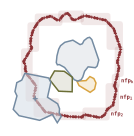

<p align="center">
  
</p>

<h2 align="center">Nester: Reinforcement Learning for 2D Irregular Nesting</h2>

<p align="center">
  <a href="https://arxiv.org/abs/2606.10611"></a>
  <a href="https://drive.google.com/drive/folders/1dkK3cKSUBCBb6VLUEkslMM7S3BtNz9cf?usp=drive_link"></a>
</p>

**One codebase for learning and evaluating 2D irregular nesting policies.** Nester couples a Gym environment with exact **no-fit polygon (NFP)** geometry (CGAL), a two-stage **Polygon Transformer** policy, and PPO training. Download pretrained weights and polygon databases from Google Drive, train on your GPU, or scale out with the included **GCP Batch + Cloud Storage** templates.

## Key contributions

- **Layout-improvement MDP**: all pieces start placed; each step repositions one polygon to raise panel occupancy.
- **Two-stage policy**: Polygon Transformer encoder → rotation choice → NFP-conditioned placement.
- **Exact NFP geometry**: CGAL Minkowski sums for feasible regions.
- **Scalable bench evaluation**: `EvalPipeline` on fixed test families with a **precomputed NFP cache** (shared memory, angular bins); **NFP symmetry equivalences** (rotation / reflection) are formulated to skip redundant bindings and cut the number of Minkowski sums at eval time.
- **End-to-end RL stack**: PPO with curriculum warmup and distributed multi-GPU rollouts.

## 📦 Setup

**Python 3.12**, CUDA GPU, and the **cp312** `cgalpy` wheel from [Drive](https://drive.google.com/drive/folders/1dkK3cKSUBCBb6VLUEkslMM7S3BtNz9cf?usp=drive_link) (other Python versions: [cgal-python-bindings](https://bitbucket.org/taucgl/cgal-python-bindings)).

```bash
pip install torch==2.8.0 -r requirements.txt
pip install /path/to/cgalpy-1.0.4-cp312-cp312-linux_x86_64.whl
pip install -e .
```

Download from [Drive](https://drive.google.com/drive/folders/1dkK3cKSUBCBb6VLUEkslMM7S3BtNz9cf?usp=drive_link) and copy into the repo:

```bash
mkdir -p data/db/processed data/runs
```

| From Drive | Put here (repo root) |
|------------|----------------------|
| `cgalpy-*.whl` | install with `pip install` (not stored in repo) |
| `train_db.npz` | `data/db/processed/train_db.npz` |
| `test_families_*.npz` | `data/db/processed/` (e.g. `test_families_fam15_size8.npz`) |
| pretrained run (optional) | `data/runs/<exp>/<run>/train_config.yaml` and `data/runs/<exp>/<run>/models/checkpoint_*.pt` |

These paths match `run/local/train/config.yaml` and `run/local/eval/config.yaml`.

You can create your own database from [OSM](https://osmdata.openstreetmap.de/data/land-polygons.html) data: 
download the data, then run preprocessing.py from data_factory

```bash
python run/local/train/run.py
python run/local/eval/run.py
python run/data_factory/preprocessing.py   # optional: OSM → data/db/processed/
```

More on run scripts: [run/README.md](run/README.md).

## Documentation

Further markdown docs in the repo:

| Doc | Contents |
|-----|----------|
| [nester/ARCHITECTURE.md](nester/ARCHITECTURE.md) | Package layout (`env` + `agent`), dependency rules, control loop |
| [nester/env/ENV.md](nester/env/ENV.md) | Gym environments, observations, actions, NFP, generators |
| [nester/agent/AGENT.md](nester/agent/AGENT.md) | PoT policy, PPO training, bench eval, checkpoints |
| [run/README.md](run/README.md) | Local train/eval, data factory, GCP Batch entrypoints |

## ☁️ Cloud (GCP)

1. Upload `.npz` and checkpoints to your GCS bucket.
2. Fill in `cloud:` in `run/cloud/train/config.yaml` and `run/cloud/eval/config.yaml`.
3. `./run/cloud/train/build.sh` · `./run/cloud/eval/build.sh`

Artifacts sync to `gs://<bucket>/runs/...`.

## 📚 Citation

If you use this code, data, or models, please cite our preprint:

```bibtex
@misc{lehuger2026geometryawarereinforcementlearning2d,
  title         = {Geometry-Aware Reinforcement Learning for 2D Irregular Nesting},
  author        = {Auguste Lehuger and Guillaume Henon-Just},
  year          = {2026},
  eprint        = {2606.10611},
  archivePrefix = {arXiv},
  primaryClass  = {cs.LG},
  url           = {https://arxiv.org/abs/2606.10611},
}
```
